<div align="center">
  
</div>

<div align="center">

<a href="https://github.com/dhvajpatel">
  
</a>

<br/>


</div>

---

## 👨‍💻 About Me

```python
class Dhvaj:
    def __init__(self):
        self.role      = "AI & Data Science Undergrad"
        self.college   = "Institute of Advanced Research (IAR), Gandhinagar"
        self.location  = "Gujarat, India"
        self.focus     = ["Machine Learning", "Full-Stack Apps", "LLM Agents", "Beautiful UIs"]
        self.currently = "Building ambitious projects way beyond the syllabus"
        self.mindset   = "If it doesn't exist, build it. If it looks boring, redesign it."

    def say_hi(self):
        return "Let's collaborate!"
```

- 🔭 Building AI-powered products: assistants, banking intelligence, sales prediction, and offline Indic-language tools
- 🎨 Obsessed with polished UI: animations, dark dashboards, themed design systems
- 🌱 Exploring reinforcement learning, LoRA fine-tuning, and agentic workflows
- ⚡ Fast learner, fast shipper

---

## 🚀 Featured Projects

<table>
<tr>
<td width="50%" valign="top">

### 📈 SalesIQ
**E-Commerce Sales Prediction**<br/>
ML-powered app that forecasts e-commerce sales with a clean, data-driven interface.

[](https://github.com/dhvajpatel/SalesIQ-E-Commerce-Sales-Prediction-)

</td>
<td width="50%" valign="top">

### 🏦 Smart Bank AI
**Banking Intelligence Platform**<br/>
FastAPI + PyTorch backend with customer 360, loan prediction, spending analysis, recommendations and an LSTM spending forecaster. React dashboard with Employee and Admin roles.


</td>
</tr>
<tr>
<td width="50%" valign="top">

### 🤖 JARVIS
**Personal AI Assistant**<br/>
Tool-calling foundation with a decorator-based registry, confirmation gates for destructive actions and cross-platform PC control. Multi-provider LLM router on FastAPI + React/Electron.


</td>
<td width="50%" valign="top">

### 🎙️ Dada-Audio
**Fully Offline Audio Translation**<br/>
Speech-to-text → translation → text-to-speech across **English, Hindi and Gujarati**, with IndicTrans2 fine-tuned via LoRA. No cloud needed.


</td>
</tr>
<tr>
<td width="50%" valign="top">

### 💸 FinPulse
**Daily Money Tracker + Loan Readiness**<br/>
Production-grade PWA that tracks daily income, spends and savings, then predicts loan eligibility with a deterministic, unit-tested engine.


</td>
<td width="50%" valign="top">

### 🧾 Tally Invoice Agent
**Natural Language → Tally Invoices**<br/>
AI agent that turns plain-English billing requests into Tally-compatible XML/JSON using LLM entity extraction.


</td>
</tr>
</table>

> 🎰 Also shipped: **CyberBandit**, a deployed neon casino game. Check my repos!

---

## 🛠️ Tech Arsenal

<div align="center">

**Languages**


**AI / ML**


**Frontend**


**Backend & Tools**


</div>

---

## 📊 GitHub Activity

<div align="center">


<br/><br/>


</div>

---

## 🤝 Let's Connect

<div align="center">

[](https://github.com/dhvajpatel)
[](https://linkedin.com/in/dhvaj-a-patel)
[](mailto:pdhvaj58@gmail.com)

<br/>

*"Talk is cheap. Show me the commits."* 💻

<br/>


</div>
